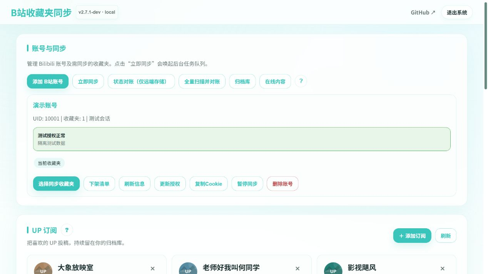
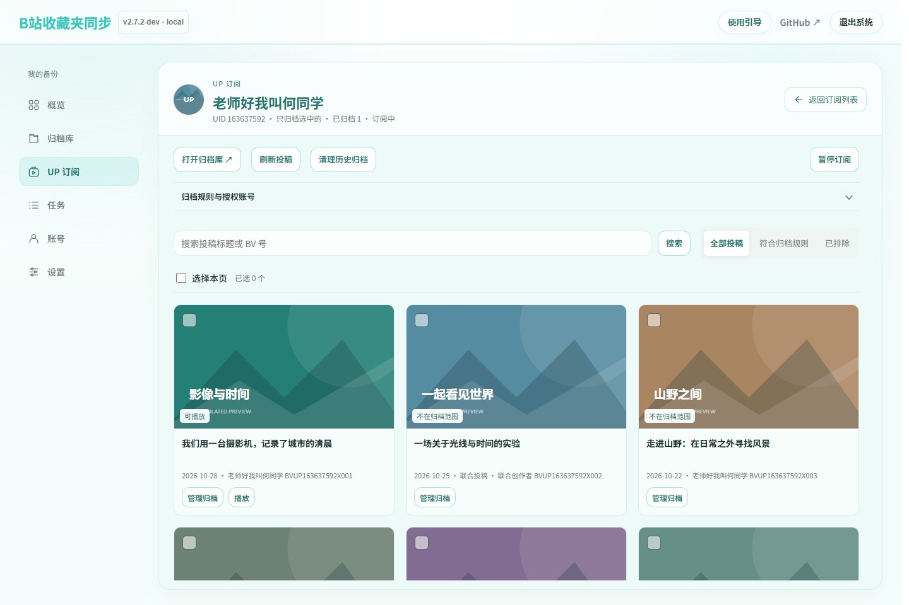
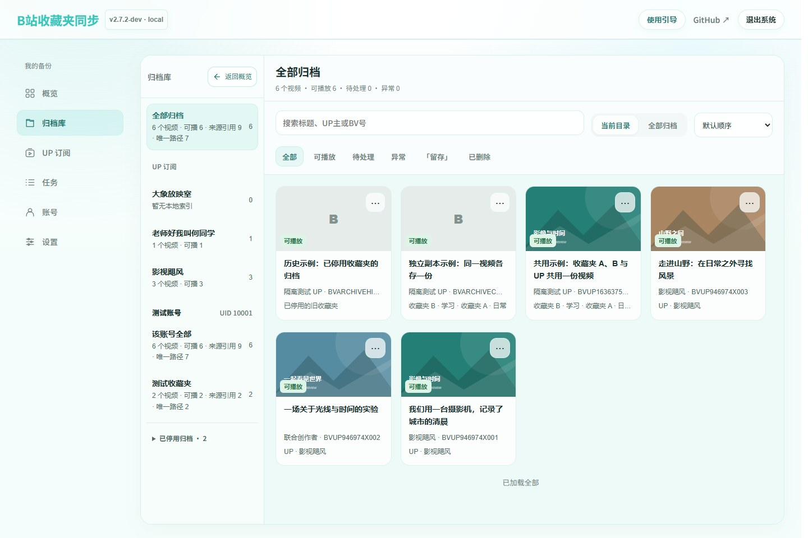

# BFB · B站收藏夹归档

[](https://github.com/minori0721/Bili-favorites-backup/releases/latest) [](https://hub.docker.com/r/minori0721/bili-favorites-backup) [](https://nodejs.org/)

将B站收藏持续备份到 AList / OpenList，让已经保存的视频、封面和收藏记录，在源视频失效后仍可查看。

[快速部署](#快速部署) · [完整文档](https://minori0721.github.io/Bili-favorites-backup/) · [最新版本](https://github.com/minori0721/Bili-favorites-backup/releases/latest) · [更新记录](CHANGELOG.md)



> 界面截图更新于 2026-10-28，基于 2.7.2-dev，使用隔离演示数据；正式版界面以对应版本为准。

Bili-favorites-backup（BFB）是一个自托管的收藏夹备份工具。它定时检查收藏、下载视频、上传网盘并核验归档结果；你可以在自己的归档库中搜索和播放，不必依赖视频仍在B站可见。

**留档优先保留旧版，不是持续追新。** 已有完整旧归档时，普通同步不会自动用新版覆盖。BFB只能保护已经成功保存的内容，不能找回从未备份的失效视频。

## 能做什么

| 能力 | 使用体验 |
| --- | --- |
| 自动归档 | 多账号、多收藏夹定时同步，通过标准WebDAV连接 AList / OpenList |
| UP 订阅 | 从关注、搜索或 UID 添加 UP，按全部投稿、指定起点或单独选择持续归档 |
| 旧档保护 | 保留收藏历史与归档封面，新尝试失败不会替换已有归档 |
| 断点与恢复 | 下载断点、上传确认和恢复任务持久保存；可自动处理的异常在后台复核，需要决定的事项集中到“待处理” |
| 归档播放 | 搜索、筛选和连续播放已验证归档；浏览归档库不请求B站或扫描网盘目录 |
| 在线手动归档 | 浏览在线收藏、订阅合集、追番追剧、稍后再看和历史；可解析为视频的条目支持手动归档 |
| 画质与编码 | 设置HEVC / AVC / AV1偏好；手动归档和换规格重试可探测可用组合、预计大小，并严格选择已有源 |

播放优先使用合适的网盘直链，不可用时回退BFB代理。**不提供转码**，选择HEVC或AV1不会把AVC重新编码；播放能力也取决于浏览器。

<details>
<summary>查看 UP 订阅与归档库界面</summary>

**UP 投稿选择**：查看已发现投稿，选择归档范围，并分别管理排除与播放。



**本地归档库**：按来源浏览已保存的视频；UP 目录按发布时间排序。



</details>

## 快速部署

当前镜像支持 **Linux amd64**。下面两种方式任选一种，保存为 `docker-compose.yml`。

### 已有 AList / OpenList

只运行BFB，不会创建或修改你的存储服务：

```yaml
services:
  app:
    image: minori0721/bili-favorites-backup:latest
    container_name: bili-favorites-backup
    restart: unless-stopped
    ports:
      - "3000:3000"
    environment:
      ADMIN_USER: ${ADMIN_USER:-admin}
      ADMIN_PASS: ${ADMIN_PASS:?请在.env中设置ADMIN_PASS}
      SESSION_SECRET: ${SESSION_SECRET:?请在.env中设置SESSION_SECRET}
      ALLOW_COOKIE_EXPORT: "false"
      TRUST_PROXY: ${TRUST_PROXY:-false}
      COOKIE_SECURE: ${COOKIE_SECURE:-false}
    volumes:
      - ./data:/app/data
      - ./temp:/app/temp
```

<details>
<summary>还没有存储服务：同时部署BFB与AList</summary>

使用下面这份完整Compose，替代上面的示例。AList固定版本沿用项目内置方案，网盘需要在AList中另行添加。

```yaml
services:
  app:
    image: minori0721/bili-favorites-backup:latest
    container_name: bili-favorites-backup
    restart: unless-stopped
    ports:
      - "3000:3000"
    environment:
      ADMIN_USER: ${ADMIN_USER:-admin}
      ADMIN_PASS: ${ADMIN_PASS:?请在.env中设置ADMIN_PASS}
      SESSION_SECRET: ${SESSION_SECRET:?请在.env中设置SESSION_SECRET}
      ALLOW_COOKIE_EXPORT: "false"
      TRUST_PROXY: ${TRUST_PROXY:-false}
      COOKIE_SECURE: ${COOKIE_SECURE:-false}
    volumes:
      - ./data:/app/data
      - ./temp:/app/temp
      - ./alist:/app/alist:ro
    depends_on:
      - alist

  alist:
    image: xhofe/alist:v3.61.0
    container_name: bili-favorites-backup-alist
    restart: unless-stopped
    ports:
      - "5244:5244"
    environment:
      PUID: "0"
      PGID: "0"
      UMASK: "022"
      ALIST_ADMIN_PASSWORD: ${ALIST_ADMIN_PASSWORD:?请在.env中设置ALIST_ADMIN_PASSWORD}
    volumes:
      - ./alist:/opt/alist/data
```

同时在下方 `.env` 中增加 `ALIST_ADMIN_PASSWORD`，设置另一个强密码。AList管理页面为 `http://服务器地址:5244`。

</details>

### 设置密码并启动

在同目录创建 `.env`，将占位文字替换为独立强密码和足够长的随机密钥，不要公开此文件。示例会在变量缺失或为空时拒绝启动，但不能识别你是否仍在使用占位文字。

```dotenv
ADMIN_PASS=请替换为独立强密码
SESSION_SECRET=请替换为足够长的随机字符串
```

```bash
docker compose pull
docker compose up -d
docker compose logs --tail=100 app
```

访问 **`http://服务器地址:3000`**，使用 `admin` 和你设置的密码登录。公网访问建议通过HTTPS反向代理，并限制管理端口的访问范围。

**反向代理配置提醒：** 域名本身无需写入BFB。直连HTTP保持 `TRUST_PROXY=false`、`COOKIE_SECURE=false`；宝塔 / Nginx反代需要将 `TRUST_PROXY` 设置为实际连接BFB的代理IP/CIDR，HTTPS同时设置 `COOKIE_SECURE=true`。Docker下来源不一定是 `127.0.0.1`，并且应限制绕过代理的源端口访问。见[完整配置步骤](https://minori0721.github.io/Bili-favorites-backup/operations/security#反向代理与登录安全)。

### 第一次归档

1. 在设置中填写BFB容器可访问的存储地址、WebDAV账号和归档目录。
2. 运行“只读检查存储连接”确认目录可读，然后登录B站账号。
3. 先手动归档一个小视频，验证下载、上传和远端确认流程，再选择需要自动同步的收藏夹。
4. 在任务中心看进度，在归档库查看已经完成的内容。

内置AList的通信地址为 `http://alist:5244`。外接服务请使用容器实际可达地址：`127.0.0.1` 指向BFB容器自身，`openlist` 这样的服务名仅在共享Docker网络中可解析。BFB自动处理 `/dav`，不要填成 `/dav/dav`；播放器的网页访问地址可单独设置。

详细步骤：[Docker部署](https://minori0721.github.io/Bili-favorites-backup/guide/docker) · [接入OpenList](https://minori0721.github.io/Bili-favorites-backup/alist/openlist) · [存储与权限](https://minori0721.github.io/Bili-favorites-backup/alist/storage)

## 数据保护与升级

**不要省略或清空持久化挂载。**

| 目录 | 保存内容 |
| --- | --- |
| `./data` | 数据库、账号与配置、归档证明、永久归档封面 |
| `./temp` | 下载断点、下载清单及尚未确认远端成功的本地成品 |
| `./alist` | 仅内置方案需要，保存AList配置与挂载信息 |

- 有效本地成品在远端尚未可靠确认时受到保护，不因缓存压力或任务失败自动释放。“停止本次尝试”不等于删除文件。
- 移除账号默认只移除登录，已有归档、封面和收藏历史保留；远端清理需单独确认。
- 归档封面不受在线缩略图缓存的自动淘汰影响；手动清理归档封面属于危险操作。
- 已有归档时，使用“迁移归档路径”调整目标目录，不要通过清空数据库或直接修改路径绕过保护。

升级BFB时保留挂载，只更新 `app` 服务：

> **当前dev升级提醒：** 默认的一跳代理信任已移除。已有反代部署更新前也要配置 `TRUST_PROXY` 并核对HTTPS Cookie模式。自定义Compose需显式传入这两个变量，仅写 `.env` 不够；配置变化需重建容器生效。具体步骤见上面的安全配置链接。

```bash
docker compose pull app
docker compose up -d --no-deps app
docker compose logs --tail=100 app
```

顶部版本入口可查看正式版更新说明，**不会自动拉镜像或重启**。拉取失败时旧容器可能仍在运行，请以启动日志中的版本与提交确认更新结果。

`v2.7.0` 增加 UP 订阅，首次启动自动将 SQLite schema 11 升级到 12，并在 `data/backups` 保留经校验的升级前快照。JSON 状态 schema 13 与迁移包清单 schema 3 不变；旧版不能直接读取 schema 12，回滚需恢复升级前的数据备份。宝塔 / Nginx 反代部署还需显式配置 `TRUST_PROXY`，HTTPS 同时配置 `COOKIE_SECURE=true`。更新前请阅读[升级说明](https://minori0721.github.io/Bili-favorites-backup/operations/update)与[数据迁移](https://minori0721.github.io/Bili-favorites-backup/operations/migration)。

## 常见问题

**为什么上传后还在等待确认？**

网盘可能延迟显示文件，上传响应也不等于归档已经可靠完成。BFB按远端证据复核；`405`、超时等异常不会直接被当成“文件不存在”，也不会因此盲目重复上传。需要你决定时会显示在“待处理”。[恢复说明](https://minori0721.github.io/Bili-favorites-backup/features/recovery)

**视频在B站失效了怎么办？**

已有归档不受源站失效影响。尚未保存的内容会停止无意义下载，并持续低频复核；重新取得有效详情和分P后可恢复归档。复核不能让源视频重新出现，也不能保证恢复后立即发现。

**HEVC视频为什么不能播放？**

浏览器或设备可能不支持该编码，切换代理不能解决解码问题。可用支持该格式的播放器打开；换编码重试只选择B站仍提供的源，不转码，也不保证源仍可下载。

**AList / OpenList之外的WebDAV能用吗？**

BFB使用通用WebDAV，不调用两者的私有REST API。但不同服务与网盘驱动支持的方法不同，不能保证所有后端兼容。普通上传不依赖MOVE，路径迁移等操作还有额外能力要求。[兼容范围](https://minori0721.github.io/Bili-favorites-backup/reference/compatibility)

## 安全与开发

- 镜像完整漏洞核验与剩余问题见 [镜像安全说明](docs/development/image-security.md)。需要进一步限制容器权限时，可在核对挂载权限后叠加仓库中的 `docker-compose.security.yml`；该文件不会自动修改现有部署或数据所有者。

- 使用独立强密码，妥善保管 `.env`、`data` 和迁移包，其中可能含账号凭据。不要直接公开日志或备份。
- 不需要导出B站Cookie时保持 `ALLOW_COOKIE_EXPORT=false`。反向代理只信任明确配置的 `TRUST_PROXY` 来源；HTTPS设置 `COOKIE_SECURE=true`，纯HTTP不要开启。
- 仅备份你有权访问和保存的内容；BFB不绕过隐私、付费权限或审核限制。

| 镜像标签 | 用途 |
| --- | --- |
| `latest` | `main`稳定版 |
| `v2.7.1` | 当前固定稳定版本，便于可控升级 |
| `v2.7.0` | 上一固定稳定版本 |
| `dev` | 开发测试版，不保证与稳定版一致 |

开发版使用下一目标版本的 `-dev` 标识，当前版本见 [dev 分支包信息](https://github.com/minori0721/Bili-favorites-backup/blob/dev/package.json)，同一周期的具体构建由提交 SHA 区分；镜像地址仍使用 `:dev`。[版本切换与发布流程](docs/development/architecture.md#开发版本与发布周期)。

[开发预览与更新说明](https://github.com/minori0721/Bili-favorites-backup/releases/tag/dev-preview)标记为 Pre-release，在 dev 镜像验收并发布成功后更新同一个页面，包含本次提交、更新时间和固定镜像摘要。开发预览不代表正式版本，不会替代正式 Latest；使用 `:dev` 的用户继续按原方式拉取镜像。

镜像仓库为 `minori0721/bili-favorites-backup`，当前仅发布 `linux/amd64`。源码使用Node.js 24：

```bash
npm ci
npm test
npm run build
```

本地修改可按范围运行 `npm run test:release`、`npm run test:core` 或 `npm run test:files -- <文件...>`；大数据专项入口为 `npm run test:slow`。`npm test` 和 CI 继续执行全部回归，具体选择见[开发与验证](docs/development/architecture.md#开发与验证)。

项目固定BBDown fork与FFmpeg版本，不在构建时跟随上游master。`v2.7.1` 镜像内置 [BBDown bfb-2.0.7](https://github.com/minori0721/BBDown/releases/tag/bfb-2.0.7)，支持结构化媒体探测与互动视频完整可达片段清单；最终媒体信息以ffprobe为准。开发与验证方式见 [开发说明](DEV_NOTES.md)。

## 许可证

BFB 自有代码按 [GNU GPLv3（仅第 3 版）](LICENSE)发行，允许使用、修改及商业分发；分发受该许可覆盖的版本时，应保留许可并向接收者提供对应源码。软件不提供担保。账号凭据、个人配置与归档媒体不属于需要公开的程序源码。

第三方组件保留各自许可证，详见[第三方声明](THIRD_PARTY_NOTICES.md)及[固定源码与构建来源](THIRD_PARTY_SOURCES.md)。新镜像在 `/app/LICENSE`、`/app/THIRD_PARTY_NOTICES.md`、`/app/THIRD_PARTY_SOURCES.md` 和 `/app/licenses/` 保留这些材料；npm 依赖自带的版权文件仍在 `/app/node_modules/`。FFmpeg 静态依赖的完整对应源码链及旧工具包的随包声明仍需补齐，已在来源说明中列出，不将本次文档补充视为全部分发材料已完成。

## 鸣谢

- [BBDown](https://github.com/nilaoda/BBDown) · [BFB维护的fork](https://github.com/minori0721/BBDown)
- [AList](https://alist.nn.ci/)
- [OpenList](https://github.com/OpenListTeam/OpenList) · [官方文档](https://doc.oplist.org/)
- [Artplayer](https://artplayer.org/)
- [biliAPI](https://github.com/renmu123/biliAPI)
- [FFmpeg](https://ffmpeg.org/)
- [Bilibili API Collect](https://socialsisteryi.github.io/bilibili-API-collect/)
